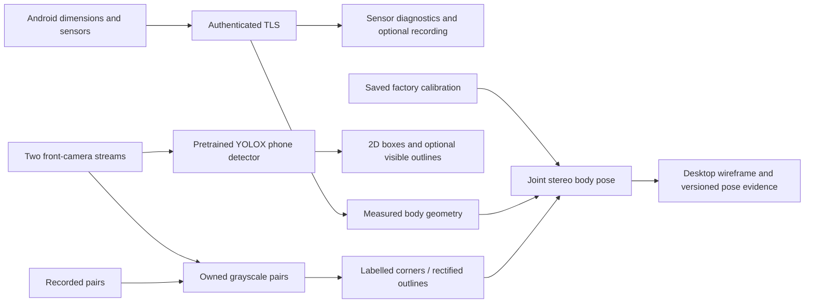

# Architecture

Android captures motion sensors and serves measured body dimensions over an
authenticated TLS link. The Frame desktop displays telemetry and controls a
native stereo body-pose diagnostic. Optical measurements are not yet fused
with IMU observations.

| Component | Responsibility |
| --- | --- |
| Android `link/` | TLS identity, discovery, approval, sensor capture and explicit service lifecycle. |
| `phone_link.py`, `phone_panel.py` | Pairing, pinned reconnect and bounded live sensor diagnostics. |
| `CameraFrame`, `RecordedFrameSource` | Owned Gray8 data, source-clock timestamps, metadata and PGM replay. |
| `FrametopRing` | Bounded read-only ring copies and writer/sequence checks. |
| `geometry.hpp`, `RigCamera` | Shared points, calibration, KB4 projection/rays and head transforms. |
| `StereoFramePairer` | Fresh two-view capture pairing within 3 ms, with bounded queues. |
| `PhoneBodyModel`, `MarkerlessPoseEstimator` | Body-center geometry, IPPE/triangulated seeds and joint stereo refinement. |
| `MarkerlessTracker` | Rectified contours, side-line fits, local association and latched loss. |
| `StereoRecorder` | Raw PGM pairs and timestamped replay manifests. |
| `markerless_panel.py`, `telemetry_recording.py` | Selection/replay UI, exact-pair previews and opt-in bounded sensor evidence. |
| `phone_detection.py`, pinned YOLOX-S | CPU phone-category acquisition, visible 2D contour proposals and bounded diagnostic output; no metric pose. |

OpenCV supplies camera transforms, PnP, SVD, optimization and image processing.
Frametop's camera broker and calibration/ray/pairing utilities retain their
[provenance](../third_party/frametop/README.md). The privileged broker is separate
from the unprivileged tracking and desktop processes.

Only `measured` results are current optical measurements. Loss/ambiguity cannot
promote an old pose into a new one. All transforms, units and clocks are explicit.
The shared capture-clock label requires hardware validation. Host arrival time
is not camera exposure time.

See [coordinates](COORDINATE_SYSTEMS.md), [pairing](PAIRING_AND_IMU.md), and
[markerless contracts](MARKERLESS_DIAGNOSTIC.md). Future integration of detector proposals and
silhouette tracking can use these interfaces without reintroducing UI-specific
geometry. The OpenVR demo remains a separate simulated rendering experiment.
