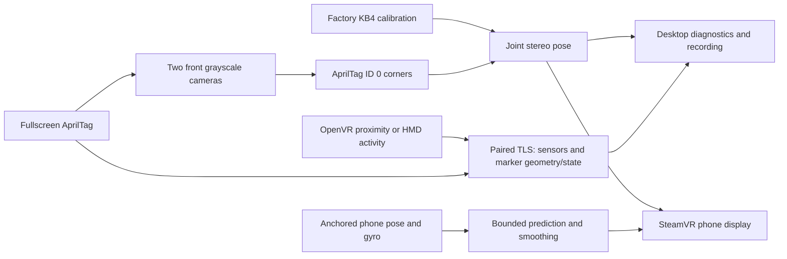

# Architecture

The phone briefly displays a width-filling AprilTag. Frame measures its pose in
two front grayscale cameras, registers anchored ARCore motion to SteamVR standing
space, then renders a screen-sized display in a 3D phone shell with bounded prediction and visual smoothing.
An independent monitor uses headset proximity, with SteamVR activity as a fallback, to gate acquisition.
Raw IMU telemetry remains available alongside the tracking path.

| Component | Responsibility |
| --- | --- |
| Fiducial / MarkerOverlay | Automatic application-overlay raster, geometry and visibility. |
| Android link / phone_link.py | Bluetooth-established pinned Wi-Fi reconnect, sensor/clock diagnostics and marker state. |
| [Camera module](../modules/camera/) broker / FrametopRing | Camera access and bounded read-only ring copies. |
| RigCamera / StereoFramePairer | Imported KB4 pixel rays and fresh pairs within 3 ms. |
| TagDetector / PlanarPoseEstimator | Decoded corners, stereo/IPPE hypotheses and joint pixel refinement. |
| fiducial_panel.py | Tracking controls, exact-pair camera outlines, freshness and process lifecycle. |
| camera_previews.py / fiducial --preview-ring | Per-camera detection and annotated Gray8 previews with one-frame queues. |
| framephone-overlay | Convex OpenVR phone shell, rear diagnostics, raw registration, bounded prediction/smoothing and loss fade; separate presence mode reads wearer input before acquisition. |
| StereoRecorder / telemetry_recording.py | Opt-in bounded camera and sensor evidence. |

Only status `measured` supplies a current pose. Ambiguous hypotheses remain
purely diagnostic. Stopping, hiding the phone marker, changing its profile or
losing the connection clears the valid pose and fades the VR object over 500 ms.
The fade is presentation only and cannot acknowledge alignment. The renderer
independently rejects pose publications older than 250 ms on the host clock.
That timestamp measures processing/publication freshness, not exposure age.

Camera processing requires a fresh authenticated phone marker-visible signal.
The broker's demand file disables trace collection and image copies while idle,
retaining the ring and authorization for prompt resume. Each visible camera view
uses one native preview worker only during acquisition before the tracker starts.
A running stereo tracker supplies its own paired previews to avoid duplicate
detection. Hiding views stops preview processing; optical acquisition continues.
ARCore handoff idles optics again while the VR rectangle follows phone poses.
Pose axes use only the exact synchronized pair; missing preview slots never
suppress valid pose telemetry.

The VR helper is separate from tracking/TLS and discovers the installed SteamVR
client. It neither registers a device driver nor replaces the scene application.
Factory-head/runtime-head alignment and capture-to-runtime timing are provisional;
this is a slow-motion calibration surface, not a world-stabilized product.
See [VR display](VR_DISPLAY.md) and the [roadmap](../../docs/ROADMAP.md).

The automatic [ARCore handoff](ARCORE_HANDOFF.md) adds a phone camera service,
negotiated poses/acknowledgments on the existing TLS link, a latest-only off-UI pose publisher, and a native
headset-relative stability registration step. After acceptance, the renderer uses SteamVR
standing space and anchored phone motion; optical detection sleeps until another
visible marker acquisition. Camera access remains in the independent module.
Sensor/screen origins and observation timing are provisional in this prototype.

## Source boundaries

The camera module owns its reader headers/sources, broker, licenses, examples
and hardware-free tests. The application links it through FramePhone::Camera.
It has no dependency on tracking, Android pairing, UI or SteamVR.

Geometry and fiducial tracking remain separate native libraries in the main
build. The desktop orchestrates those executables; the renderer consumes accepted
pose messages. See the [reuse guide](../../docs/REUSING.md) before copying code or
adding cross-layer dependencies.

The desktop uses one dashboard. Its fixed front pair is declared in
front_cameras.py; saved camera assignments are not loaded and no camera selectors
are exposed. Startup launches wearer monitoring, camera authorization and
Bluetooth advertising. Pairing is exclusively through Android's companion picker
and a verified TLS connection over the Bluetooth bond. Wi-Fi connects automatically from the verified
Bluetooth route, with capped retry backoff and another route exchange on phone
screen-on/unlock while disconnected. There are no IP fields, LAN scans or
transport buttons. Bluetooth status is always visible; the only headset pairing
control is Forget phone. The activity log expands inline. Tracking, ARCore and
the VR rectangle are automatic; raw sensor telemetry and recording remain
independent from optical pose estimation.

`pose_stream.py` owns bounded renderer publication rather than the Tk timer.
`pose_prediction.hpp` predicts briefly from the latest measured ARCore pose;
validated post-exposure gyro samples affect rotation, and recent ARCore velocity
affects translation. Predictions never enter the optical registration/history.
The renderer measures cadence and age independently from UI refresh.
`phone_model.hpp` owns physical shell geometry and textures; `tracking_fade.hpp`
fades tracking in over 250 ms and out over 500 ms, advancing rotation only from fresh,
verified gyro data. Neither presentation component changes registration.

## Bluetooth companion transport

The BlueZ integration lives in bluetooth_link.py; bluetooth_tls.py provides a
transport-independent TLS 1.3 byte stream and bluetooth_protocol.py the pose codec. It
owns an asyncio thread and supplies authenticated LAN endpoints for PhoneLink.
Android bluetooth/ owns association/presence, GATT lifecycle and the shared binary
contract. ArPoseService and SensorFeed publish poses and raw diagnostics over Wi-Fi.
After no-code OS bonding, TLS over BLE and a hash approved on both devices
establish app trust. Saved trust authenticates subsequent sessions and their LAN route.
Video is a future separate path. See [Bluetooth contract](BLUETOOTH.md).
