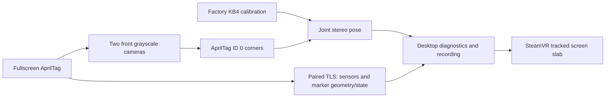

# Architecture

The phone keeps a single width-filling AprilTag visible. Frame measures its pose
in the two front grayscale cameras. IMU data is diagnostic; neither IMU integration
nor ARCore supplies motion in this milestone.

| Component | Responsibility |
| --- | --- |
| Fiducial / MarkerActivity | Integral-pixel marker raster, fullscreen geometry and visibility. |
| Android link / phone_link.py | LAN pairing, pinned reconnect, sensor/clock diagnostics and marker state. |
| Frametop broker / FrametopRing | Camera access and bounded read-only ring copies. |
| RigCamera / StereoFramePairer | Imported KB4 pixel rays and fresh pairs within 3 ms. |
| TagDetector / PlanarPoseEstimator | Decoded corners, stereo/IPPE hypotheses and joint pixel refinement. |
| fiducial_panel.py | Tracking controls, exact-pair camera outlines, freshness and process lifecycle. |
| camera_previews.py / fiducial --preview-ring | Per-camera detection and annotated Gray8 previews with one-frame queues. |
| framephone-overlay | Six pose-driven screen-slab faces through OpenVR; hides stale/lost data. |
| StereoRecorder / telemetry_recording.py | Opt-in bounded camera and sensor evidence. |

Only status `measured` supplies a current pose. Ambiguous hypotheses remain
purely diagnostic. Stopping, hiding the phone marker, changing its profile or
losing the connection clears the pose and hides the VR object. The renderer
independently rejects pose publications older than 250 ms on the host clock.
That timestamp measures processing/publication freshness, not exposure age.

Each visible camera view has one native preview worker. It detects and annotates
its own source frames, independently of phone pairing or stereo tracking, and
Python retains only the newest image per camera. Hiding the views stops these
workers; tracking and the VR display continue. Pose axes use only the exact
synchronized tracking pair. Missing preview slots do not suppress valid pose
telemetry. Waiting streams and worker errors are reported per camera.

The VR helper is separate from tracking/TLS and discovers the installed SteamVR
client. It neither registers a device driver nor replaces the scene application.
Factory-head/runtime-head alignment and capture-to-runtime timing are provisional;
this is a slow-motion calibration surface, not a world-stabilized product.
See [VR display](VR_DISPLAY.md) and the [roadmap](../../docs/ROADMAP.md).
