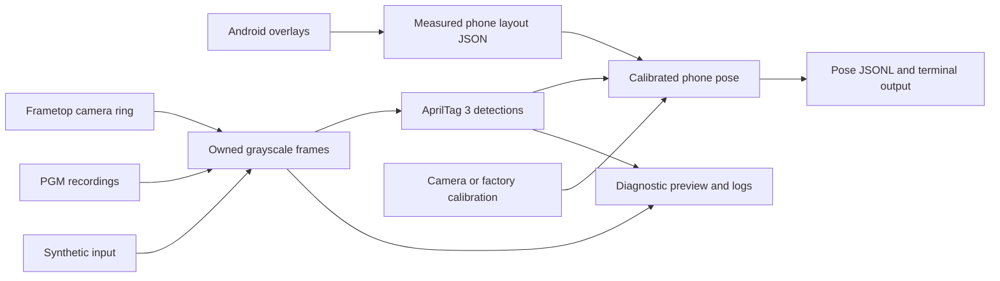

# Architecture

FramePhone has two independent applications. `phone/` is an Android app that
renders markers and exports measured geometry. `frame/` is a native C++20/Linux
tracker that consumes camera images and that export. There is no live network
connection between them; an operator transfers the JSON layout for each fixed
phone configuration.

## Data flow

The OpenVR outline demo is separate from this flow and uses simulated geometry.
It does not demonstrate live tracked rendering.

## Android modules

| Directory / class | Responsibility |
| --- | --- |
| `geometry/` | Physical layout math, Android display measurements and versioned JSON export. |
| `markers/` | Pinned tag36h11 family data and whole-pixel raster drawing. |
| `overlay/FiducialService` | Explicitly enabled foreground service with one small overlay window per tag. |
| `MainActivity` / `SettingsStore` | Calibration, layout selection, permissions, local preferences and export. |

Calibration is based on manually measured active display dimensions. Each axis
has its own physical pixel scale. Phone-frame marker anchors and raster orientation
remain stable across display rotation; measured bounds drive exported geometry.
No Accessibility service, networking or IMU sampling is used.

## Native modules

| Interface / source | Responsibility |
| --- | --- |
| `CameraFrame`, `camera_source.cpp` | Owned Gray8 pixels, dimensions/stride, camera/calibration identity and source-clock capture time; synthetic and PGM replay sources. |
| `FrametopRing`, `frametop_ring.cpp` | Read-only bounded ring copies, sequence checks, stale-writer handling and separate host transport timestamps. |
| `AprilTag36h11Detector` | Real full-resolution AprilTag 3 detection for the supported phone IDs 0–5. |
| `PhoneLayout`, `pose.cpp` | Export validation, canonical corner association, single-camera IPPE hypotheses and whole-tag consensus. |
| `RigCamera`, `frametop_calibration.cpp` | Factory KB4 intrinsics, camera-to-head transforms, calibrated rays and triangulation. |
| `StereoFramePairer`, `StereoPoseEstimator` | Fresh two-view capture pairing, rigid-phone seeds and joint distorted-pixel refinement. |
| `diagnostic.cpp`, `diagnostic_view.cpp` | Detection statistics, CSV and optional SDL display. |
| `*_main.cpp` / `main.cpp` | CLI orchestration and the optional renderer demo; see the executable table in the native README. |

OpenCV supplies SVD, camera projection/PnP and LM optimization; AprilTag supplies
decoding. Frametop's MIT calibration/ray math and pairing policy are adapted with
[provenance](../third_party/frametop/README.md). The privileged camera broker is
an external host process, not part of the tracker.

## Invariants

Physical units are meters; transform direction and output frame are explicit.
Capture timestamps retain their original clock label and integer precision.
Host dequeue/publication times are not substituted for capture times. A shared
clock label must be verified on hardware before stereo pairing.

A phone layout must match the actual display configuration. Detector corners
use AprilTag's canonical order, not the export's display TL/TR/BR/BL order.
The loader applies the raster-rotation permutation.

Only `accepted` results are usable. Loss, rejection and unresolved ambiguity
never turn an earlier pose into a current measurement. Whole markers, not
individual convenient corners, determine consensus.

## Future integration

World tracking needs capture-to-XR time mapping and historical headset poses:
`T_WP(t) = T_WH(t) * T_HP(t)`. A current headset pose cannot replace the pose at
capture time. Reference-space resets, filtering, prediction and VR rendering
remain separate work described in the [roadmap](../../docs/ROADMAP.md).
