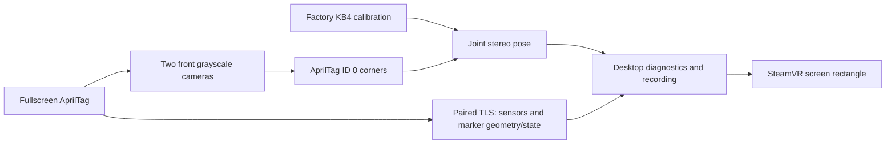

# Architecture

The phone keeps a single width-filling AprilTag visible. Frame measures its pose
in the two front grayscale cameras. IMU data is diagnostic; neither IMU integration
nor ARCore supplies motion in this milestone.

| Component | Responsibility |
| --- | --- |
| Fiducial / MarkerOverlay | Automatic application-overlay raster, geometry and visibility. |
| Android link / phone_link.py | LAN pairing, pinned reconnect, sensor/clock diagnostics and marker state. |
| [Camera module](../modules/camera/) broker / FrametopRing | Camera access and bounded read-only ring copies. |
| RigCamera / StereoFramePairer | Imported KB4 pixel rays and fresh pairs within 3 ms. |
| TagDetector / PlanarPoseEstimator | Decoded corners, stereo/IPPE hypotheses and joint pixel refinement. |
| fiducial_panel.py | Tracking controls, exact-pair camera outlines, freshness and process lifecycle. |
| camera_previews.py / fiducial --preview-ring | Per-camera detection and annotated Gray8 previews with one-frame queues. |
| framephone-overlay | One screen-sized OpenVR quad driven by the latest fiducial pose; hides stale/lost data. |
| StereoRecorder / telemetry_recording.py | Opt-in bounded camera and sensor evidence. |

Only status `measured` supplies a current pose. Ambiguous hypotheses remain
purely diagnostic. Stopping, hiding the phone marker, changing its profile or
losing the connection clears the pose and hides the VR object. The renderer
independently rejects pose publications older than 250 ms on the host clock.
That timestamp measures processing/publication freshness, not exposure age.

Each visible idle camera view has one native preview worker. It detects and annotates
its own source frames, independently of phone pairing or stereo tracking, and
Python retains only the newest image per camera. Hiding the views stops these
workers; a running tracker also stops them to avoid duplicate detection, supplying
its own paired previews instead. Tracking and the VR display continue. Pose axes use only the exact
synchronized tracking pair. Missing preview slots do not suppress valid pose
telemetry. Waiting streams and worker errors are reported per camera.

The VR helper is separate from tracking/TLS and discovers the installed SteamVR
client. It neither registers a device driver nor replaces the scene application.
Factory-head/runtime-head alignment and capture-to-runtime timing are provisional;
this is a slow-motion calibration surface, not a world-stabilized product.
See [VR display](VR_DISPLAY.md) and the [roadmap](../../docs/ROADMAP.md).

The automatic [ARCore handoff](ARCORE_HANDOFF.md) adds a phone camera service,
negotiated poses/acknowledgments on the existing TLS link, and a native
headset-relative stability registration step. After acceptance, the renderer uses SteamVR
standing space and anchored phone motion; optical detection sleeps until another
visible marker acquisition. Camera access remains in the independent module.
Sensor/screen origins and observation timing are provisional in this prototype.

## Source boundaries

The camera module owns its reader headers/sources, broker, licenses, examples
and hardware-free tests. The application links it through FramePhone::Camera.
It has no dependency on tracking, Android pairing, UI or SteamVR.

Geometry and fiducial tracking remain separate native libraries in the main
build. The desktop orchestrates those executables; the renderer consumes accepted
pose messages. See the [reuse guide](../../docs/REUSING.md) before copying code or
adding cross-layer dependencies.

The desktop uses one dashboard. Its fixed front pair is declared in
front_cameras.py; saved camera assignments are not loaded and no camera selectors
are exposed. Startup launches camera authorization and phone discovery. Saved
phone candidates are bounded and checked with the existing certificate pin;
first-time pairing remains an explicit, fingerprint-approved action. Connection
controls and the activity log expand inline. Raw sensor telemetry and recording
remain independent from optical pose estimation.
