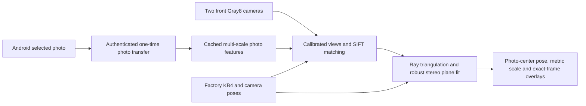

# Architecture

Android displays a user-selected photo and sends the exact prepared PNG once
over paired TLS. The Frame desktop controls native feature matching and calibrated
stereo photo pose. Output is head-relative T_HP with stereo-derived scale; raw
IMU remains diagnostic. ARCore/world alignment is not active yet.

| Component | Responsibility |
| --- | --- |
| PhotoReference / PhotoActivity | Bounded user photo decode, canonical PNG and full-screen aspect-preserving display. |
| Android link / phone_link.py | Pairing, pinned reconnect, photo transfer/state, sensors and clock diagnostics. |
| photo_reference.py | Request/session/hash/bounds validation and local reference-session preparation. |
| Frametop broker / FrametopRing | Camera access, bounded read-only ring copies, writer/sequence validation. |
| geometry.hpp / RigCamera | Shared types, factory calibration, KB4 projection/rays, head transforms. |
| StereoFramePairer | Fresh bounded pairing in one clock, <=3 ms skew. |
| PhotoTracker | Multi-scale reference features, calibrated-view matching and robust homography filtering. |
| estimate_photo_pose | Stereo intersections, robust similarity fit, native KB4 refinement and quality gates. |
| photo_panel.py | Download/start/stop, inliers, pose/scale, exact-pair overlays and stale/disconnect clearing. |
| StereoRecorder / telemetry_recording.py | Opt-in bounded camera/sensor evidence with source timestamps. |

The privileged camera broker is separate from unprivileged tracking/TLS/UI.
No neural weights or Python OpenCV runtime are needed. Only status measured
supplies a current pose; alternatives are diagnostic. Camera clock mapping,
factory associations and metric accuracy still require hardware verification.
The old marker modules remain regression-tested but are absent from the normal
UI. [Photo tracking](PHOTO_TRACKING.md) is the implemented optical milestone;
[ARCore/screen-content alignment](SCREEN_CONTENT_TRACKING_PLAN.md) is the next architecture.
