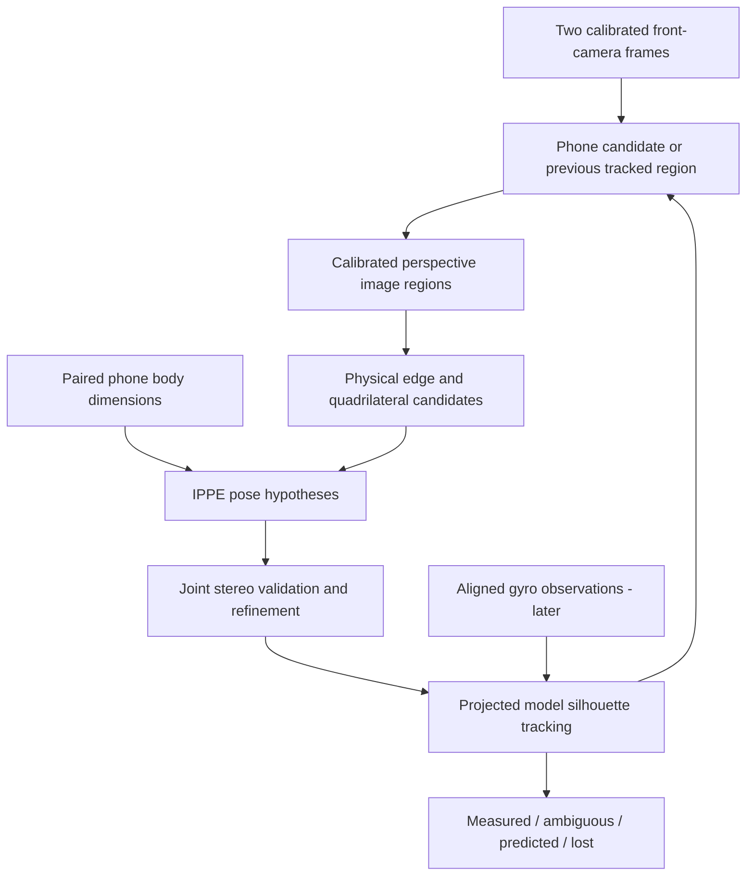

# Markerless phone pose: research and implementation plan

Research date: 2026-10-14. The [first optical diagnostic](MARKERLESS_DIAGNOSTIC.md)
now implements manual stereo initialization, body pose, complete-front-outline
tracking and recording/replay. A separate [automatic detector](AUTO_DETECTION.md)
now runs bundled pretrained YOLOX-S with visible 2D contour proposals. Its
integration into metric stereo pose, RAPID and IMU fusion remain proposals;
none of these optical paths has been benchmarked on Frame.
The owner has confirmed pairing and live sensor telemetry on the actual phone
and Steam Frame. This plan addresses the next optical tracking experiment,
using the two selected front cameras and no custom neural-network training.

## Recommendation

Use an OpenCV acquisition pipeline (phone candidate → physical outline → planar
pose hypotheses), reuse our calibration/stereo geometry, and evaluate OpenCV
RAPID for continuous model-based silhouette tracking. Add phone gyro prediction
after the optical measurements are independently testable. A pretrained phone
detector supplies a search region; it does not supply physical corners or a pose.

The initial experiment should accept manual target/corner selection as a
diagnostic fallback. That isolates geometry and tracking quality from detector
quality. It is a development tool, not the intended final pairing workflow.

## Existing components worth reusing

| Component | What already exists | Role and limitation here |
| --- | --- | --- |
| [OpenCV contours](https://github.com/opencv/opencv/blob/4.x/samples/cpp/squares.cpp) and [LineSegmentDetector](https://docs.opencv.org/4.x/db/d73/classcv_1_1LineSegmentDetector.html) | Canny/contours/polygon simplification and grayscale line detection. | First outline acquisition. Adapt the sample: its near-right-angle image test is unsuitable for a strongly perspective-tilted phone. |
| [OpenCV IPPE/PnP](https://docs.opencv.org/4.x/d5/d1f/calib3d_solvePnP.html) | Rotation/translation from known object points and calibrated image points. | General IPPE for a rectangular face. Keep both planar hypotheses; IPPE_SQUARE assumes a square. |
| [OpenCV RAPID](https://docs.opencv.org/4.x/d4/dc4/group__rapid.html) | Project a mesh silhouette, find edge correspondences, update 6DoF pose. | Best first tracker to evaluate because OpenCV is already used. Requires a reasonably close initial pose and a pinhole view; its public tracking call is monocular. |
| [ViSP generic model tracker](https://github.com/lagadic/visp/blob/master/tutorial/tracking/model-based/generic/tutorial-mb-generic-tracker.cpp) | CAD-based edge, keypoint and hybrid tracking; its example processes grayscale frames. | A useful reference/benchmark for moving-edge tracking. Its [GPL-2.0-or-later license](https://github.com/lagadic/visp/blob/master/LICENSE.txt) differs from our current permissive dependency choices. |
| [DLR M3T](https://github.com/DLR-RM/3DObjectTracking/tree/master/M3T) | Model-based tracking with multiple cameras and selectable region/texture/depth modalities. | Strong alternative benchmark with an [MIT license](https://github.com/DLR-RM/3DObjectTracking/blob/master/LICENSE). Requires mesh/setup and additional rendering dependencies. No depth camera is required for a region-only configuration, but its depth-based unknown-occlusion handling is unavailable in that configuration. |
| [ELSED](https://github.com/iago-suarez/ELSED) | C++ grayscale line-segment extraction. | Optional comparison if OpenCV line extraction proves too slow or fragmented. It does not itself output a phone pose. |

These library capabilities come from the linked primary sources; the selection
and experiment sequence are our engineering proposal. None demonstrates Frame
performance or reliability on our phone images.

RAPID's [implementation](https://github.com/opencv/opencv_contrib/blob/4.x/modules/rapid/src/rapid.cpp)
accepts one-channel images and projects without fisheye distortion. Our package
currently includes core/calib3d/imgproc, not a configured RAPID dependency. Verify
the exact API in the packaged OpenCV version, add the contrib module and runtime
library to the existing container build, and preserve dependency notices. Do not
assume current online examples exactly match the Ubuntu package API.

M3T's [build documentation](https://github.com/DLR-RM/3DObjectTracking/blob/master/M3T/readme.md)
lists Eigen, GLEW, GLFW and OpenCV. Treat renderer support and performance on
Frame as a separate experiment. Its region modality relies on foreground/
background appearance; mono images provide less discrimination than RGB. Its
precomputed geometric models are not custom neural-network training.

General pretrained 6DoF systems such as [FoundationPose](https://github.com/NVlabs/FoundationPose)
also exist, but that project's documented NVIDIA/CUDA stack is a poor first
deployment fit for our current ARM64 Frame package. It is not the initial path.

## Proposed optical pipeline

### 1. Establish the camera and body model

Use only the two physical front streams, retaining their native capture sizes,
timestamps, calibration IDs and explicit camera mapping. First verify calibration
dimensions and cross-camera geometry; neither a detected outline nor successful
telemetry validates camera calibration. Capture-skew gating alone does not
motion-compensate a moving phone between exposures.

Generate a thin cuboid from the authenticated width, height and thickness. Start
with a front-face rectangle for initialization, then use the cuboid silhouette
for oblique views. Add a measured/estimated corner radius if recordings show the
sharp model consistently misses rounded case corners. A hand and camera bump
are not part of this cuboid; unsupported boundaries must be rejected.

Introduce an explicit body frame B, centered in the body, +X right, +Y toward the
physical top, +Z through the front. Its nominal front-face points are
`(±width/2, ±height/2, thickness/2)` in meters. Solve a planar local face frame
with Z=0 for IPPE, then compose its known offset into B. Body dimensions are not
active-display dimensions; a future screen overlay needs that additional mapping.

### 2. Locate a candidate and expose the actual boundary

Use a pretrained detector only for acquisition/reacquisition, at a rate chosen
from measured inference cost. A concrete initial candidate is
[YOLOX-Tiny](https://github.com/Megvii-BaseDetection/YOLOX) with
[ncnn](https://github.com/Tencent/ncnn), which provides an ARM-oriented native
deployment route. Test the pretrained phone category on actual mono images.
Duplicating grayscale into RGB channels does not solve an RGB-to-mono domain gap.

Track the selected instance within the region between detector runs. Keep a
manual selection path for the diagnostic. Largest visible phone can be an initial
hint, but pairing a network connection does not identify an image object.
Never transfer a paired IMU stream to a different detected phone after loss.

Rectify a calibrated region into a virtual pinhole image before fitting straight
lines or calling RAPID. Raw KB4 fisheye images bend straight physical edges.
Record the virtual intrinsics, crop offsets and any virtual-camera rotation;
map results back through the real camera/head transform. Preserve useful sampling
resolution; detector input resizing need not dictate boundary-fitting resolution.
An undistortion remap cannot create detail absent from the capture.

Compare two simple outline extractors on the same regions:

- Canny → contours → polygon candidates, useful when the complete outline is visible.
- Line segments → robust side-line fits → intersections, useful for rounded
  corners and partially interrupted sides. Intersect extrapolated straight sides
  to obtain virtual rectangle corners rather than selecting arbitrary arc pixels.

Keep multiple candidates for body rim, screen rim and background rectangles.
Score edge support, convexity, pose-consistent physical proportions and stereo
agreement. Perspective does not preserve image right angles, parallel opposite
sides or the raw image width/height ratio. `minAreaRect` supplies an image-space
box, not yaw/pitch/roll or the phone's projected physical corners.

### 3. Initialize pose and check it in the second view

For sufficiently visible front-face geometry, apply calibrated
`solvePnPGeneric(..., SOLVEPNP_IPPE)` to ordered virtual corners and the known
rectangle. Retain both pose hypotheses and plausible corner assignments.
Use positive depth, expected facing, cross-view support and later temporal
continuity to score them. The [IPPE authors](https://github.com/tobycollins/IPPE)
explain why small/nearly affine planar views can have two very similar solutions.

Reproject each candidate into both cameras and refine one common `T_HB` against
both sets of observations. Reuse the existing KB4 projection, transforms,
triangulation and LM machinery. Do not average two unrelated pose matrices.
Triangulate only correspondences known to represent the same physical point.

In particular, the outer silhouette of a thick object may come from different
front/back edges in the two views. Its apparent corners are not automatically
the same four coplanar 3D points. A planar initialization is an approximation for
clear front views; the cuboid model must handle changing visible edges at tilt.

Four fitted corners are a minimal pose input, not four independent outlier tests.
Validate the whole projected outline using many supporting edge pixels and
spatial coverage. Do not claim high certainty merely from low four-corner RMS.

### 4. Track projected model edges

Evaluate RAPID with a simple mesh seeded by the accepted pose. It searches near
the projected silhouette, so it can use evidence along visible sides rather
than rediscovering four corners every time. Initialize with nearby previous pose
first; add gyro prediction later. This is local tracking, not global detection.

Start with a primary-camera tracker and independent second-view validation.
Then reuse RAPID's correspondence-building components or an observation adapter
to optimize a single pose jointly in both views. Its monocular high-level API
does not provide that integration automatically.

Use robust residuals, edge-direction agreement, visibility checks and per-side
coverage. Reject matches on screen text, reflections, fingers or background lines
where possible. Image features on changing screen content are not necessarily
rigid phone features, so generic optical flow is auxiliary evidence only.

If we build a joint residual, use projected-point-to-edge distance, with robust
weights, because motion along a straight edge is less constrained than motion
across it. Track fit conditioning and alternative minima. One visible side or
a nearly edge-on silhouette does not provide a dependable fresh six-axis pose.

### 5. Add inertial prediction and explicit loss states

First use timestamped gyro to predict orientation between valid optical updates,
after verifying sensor-to-B axes and phone/camera clock alignment. The current
telemetry offset is a diagnostic, not a verified fusion clock. Estimate biases;
introduce accelerometer prediction only after handling gravity, lever arm and
headset motion. Magnetometer heading needs disturbance and XR-heading alignment
checks; it does not solve translation.

Phone IMU and headset cameras move independently. A standard visual-inertial
odometry package that assumes its IMU is attached to its camera cannot simply
be plugged in. World-space fusion needs historical headset poses and a verified
XR time mapping; a head-relative estimator must model headset motion explicitly.

Report `measured`, `ambiguous`, `predicted` and `lost` separately, with age and
quality. Brief prediction is useful during partial occlusion. Complete occlusion
must expire into loss; gyro and accelerometer cannot supply reliable indefinite
position. Reacquire deliberately rather than freezing a previous measured pose.

## Ambiguity we must handle explicitly

A plain non-square rectangle still has 180-degree top/bottom symmetry. Two
cameras and perfect edge extraction do not label which physical end is the top.
This is separate from IPPE's weak-perspective tilt ambiguity. A body cuboid can
also have front/back symmetries if no appearance cue distinguishes its faces.

A practical initialization can use a briefly displayed asymmetric setup cue,
explicit known phone orientation, or a later motion-assisted alignment procedure.
It need not be a persistent screen-obscuring marker. Gyro can maintain a chosen
orientation, but cannot infer an unknown static initial heading by itself. After
uncertain reacquisition, retain ambiguity until new evidence establishes identity
and orientation. Manual fingerprint pairing currently supplies neither optical
phone association nor an optical top/bottom label.

## Implementation order and decision gates

1. **Record and replay real front-camera trials.** Add opt-in timestamped IMU/
   geometry/clock metadata alongside existing paired-image recordings. Include
   calibration identity and configuration. Use several static poses, tilts,
   distances, display contents, backgrounds and hand grips. Keep private captures
   outside the exported source tree.
2. **Build the geometry diagnostic.** Manual region/corner selection, known
   dimensions, IPPE alternatives, stereo reprojections, axes and body wireframe.
   Verify that measured relative movements/rotations agree with an independent
   fixture before judging automatic edge extraction.
3. **Add automatic outlines and detector proposals.** Compare contours and line
   fitting on those recordings, then test the pretrained detector. Show both the
   detector box and fitted physical outline; they are different outputs.
4. **Benchmark RAPID tracking.** Measure stability, partial occlusion, drift,
   failed-fit clearing and reacquisition. Compare M3T on the same difficult clips
   if RAPID cannot meet the evidence gates; do not assume a larger framework
   fixes absent image contrast or unresolved symmetries.
5. **Add gyro prediction and live integration.** Validate timing and axes, then
   test phone motion, head motion and both simultaneously. Introduce further
   inertial fusion only after optical error is measured.

The implemented `PhoneBodyModel`, `BodyObservation`, `MarkerlessPoseEstimator`
and `MarkerlessTracker` expose versioned body geometry and quality data. They
share camera, factory calibration, stereo pairing and recording modules.
Manual initialization and complete-front-outline tracking are implemented;
automatic acquisition, silhouette tracking and inertial fusion remain future work.

For each stage report coverage by projected phone size/tilt/grip, false locks,
median/p95 position and rotation errors where independent references exist,
stationary jitter, ambiguous/lost fractions, processing/measurement age and
reacquisition time. Compare no-IMU and gyro-assisted runs. A plausible overlay
and low reprojection error alone are not independent ground truth.

Do not promise Frame throughput or distance accuracy from published desktop
benchmarks. The first useful deliverable is a native-camera debug view showing
the fitted outline, both pose alternatives, cross-camera agreement and a clearly
qualified body pose, without any permanent fiducial overlay.
