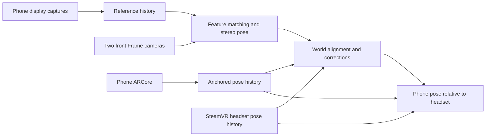

# Screen-content registration with ARCore: research and implementation plan

Research date: 2026-10-15. Proposed implementation, not a working tracker or a
measured Frame performance claim.

Implementation update, 2026-10-16: [fixed-photo stereo tracking](PHOTO_TRACKING.md)
now implements the initial optical experiment, with a phone-selected reference
sent once over paired TLS. ARCore, screen streaming and world alignment remain
future milestones. The static reference does not require MediaProjection.

## Decision and intended experience

Use ARCore for continuous phone motion and the phone's actual display content
for automatic alignment to Steam Frame. Use only the two physically front-facing
Frame cameras. No attached tracker, printed marker, persistent display marker,
manual corner picking or per-phone neural-network training.

After pairing and starting an authorized tracking/capture session, the user
unlocks the phone, brings its screen into view and uses ordinary apps or Home.
Frame acquires the screen when enough recognizable content is visible. ARCore
bridges intervals when the screen cannot be matched. Reacquire after tracking or
session loss; do not extrapolate indefinitely from raw IMU.

Android prevents promising silent operation after every pocket/lock cycle.
Consent is required for each MediaProjection session; locking the screen can
terminate it. Initially provide a notification action opening the consent flow
again when needed. This is separate from whether screen matching succeeds.
[Android capture lifecycle](https://developer.android.com/media/grow/media-projection)

## Research findings

**Augmented Visualization with Natural Feature Tracking, MUM 2011** estimates
camera pose from the known, changing content of a display without artificial
markers. It separates initial feature matching from cheaper patch tracking and
refreshes references when content changes. Its large-screen/phone-camera setup
differs from our small-screen/monochrome-headset setup. It establishes precedent
for the geometry, not Frame accuracy. Fast content changes and weak texture
remain relevant limitations.
[Author-hosted paper](https://www.cg.tuwien.ac.at/research/publications/2011/Soros_AVN_2011/Soros_AVN_2011-Paper.pdf)

**ScreenshotMatcher, MuC 2021** matches camera photographs to original display
images. Its evaluation preferred ORB with brute-force Hamming matching: 85%
success and 90 ms processing in its algorithm evaluation, versus 47% real-world
success and 878 ms mean response in a user study. These are different evaluation
conditions, not expected Frame results. It supplies a useful baseline and warns
against equating a demonstration with reliable acquisition.
[University-hosted paper](https://epub.uni-regensburg.de/47814/7/3473856.3474014.pdf)

The authors' **MIT-licensed ScreenshotMatcher repository** is worth studying for
reference preparation and match filtering. Its README identifies text-heavy
regions as unreliable. It retrieves screenshots; it is not a stereo 6DoF tracker
or ARCore fusion package. No source has been imported here.
[Official repository](https://github.com/PDA-UR/Screenshotmatcher-2.0)

**XFeat** supplies pretrained lightweight local features, sparse/semi-dense
matching and a homography demo comparing XFeat, ORB and SIFT. Its authors report
CPU operation on laptop hardware and supply pretrained XFeat/LighterGlue
examples. It is a stronger candidate for image correspondence than a generic
phone bounding-box detector. ARM64 Frame latency and rendered-UI matching are
unverified. Benchmark the official PyTorch implementation offline first; an
efficient C++/ONNX export is a separate port and parity test, not an assumed
ready-made dependency.
[Official XFeat implementation](https://github.com/verlab/accelerated_features)

**LightGlue** is another pretrained matcher for an optional offline comparison.
Its reported CPU speed is on an Intel desktop, not Frame. Code and LightGlue
weights are Apache-2.0; extractor licenses differ, including restrictive
SuperPoint terms. It is not the first package dependency.
[Official LightGlue implementation](https://github.com/cvg/LightGlue)

The reviewed **Bringing full-featured mobile phone interaction into virtual
reality, 2021** prototype uses a modified controller attached to the phone and an
extra depth sensor. Screen mirroring is relevant context, but its tracking does
not meet our no-accessory requirement.
[Author-hosted paper](https://3dvar.com/Bai2021Bringing.pdf)

No reviewed component provides this complete Frame + Android architecture as a
drop-in product. Reusable pieces are image correspondences, planar geometry,
ARCore pose, capture and headset pose; their integration is ours.

## Component choices

| Component | Initial choice | Existing work and remaining work |
| --- | --- | --- |
| Phone motion | ARCore Java/Kotlin SDK; rear camera | New dependency and service-owned session/update loop. |
| Offscreen updates | Dedicated EGL pbuffer + external OES texture | New; session lifetime must survive MainActivity.onPause. |
| Display references | MediaProjection + VirtualDisplay + ImageReader | New; whole display, rotation and consent lifecycle. |
| Identity/control | Existing paired TLS protocol | Reuse pinning, authentication and clock probes; negotiate tracking capabilities. |
| Reference transport | Separate authenticated TLS image stream, bounded binary framing | New; existing JSON messages have a 64 KiB limit. |
| Frame cameras | Existing broker, ring and stereo pairer | Reuse; verify physical front stream-to-factory mapping. |
| Headset world pose | Small OpenVR background helper | New; installed SteamVR, independent of Frametop. |
| Acquisition | OpenCV ORB + Hamming; SIFT comparison | Add explicit features2d/imgcodecs dependencies. |
| Pretrained comparison | XFeat, then optional LighterGlue | Offline candidate; ship only after a verified ARM64 port earns its cost. |
| Optical geometry | Robust homography, planar PnP alternatives, stereo refinement | Generalize four-corner solver to arbitrary screen points. |
| Alignment/recovery | Robust rigid-transform fitting and explicit states | New; histories, confidence gates, recenter/session handling. |
| Diagnostics/delivery | Existing desktop UI, replay and single .run build | Extend; keep processing off UI thread and preserve pairing. |

Pin the SDK after checking build compatibility. The official release list
currently identifies ARCore 1.56.0 as latest. This repo explicitly targets API 36;
that release notes API 37 manifest behavior for consumers without an explicit
target. Record SDK and installed Google Play Services for AR versions in trials.
[ARCore releases](https://github.com/google-ar/arcore-android-sdk/releases)

ARCore needs a supported phone and Google Play Services for AR; it is not wholly
bundled in our APK. Use AR-optional integration so pairing/telemetry remain usable
without it, with tracking explicitly unavailable. Check availability/install at
runtime.
[ARCore integration requirements](https://developers.google.com/ar/develop/java/enable-arcore)

## Phone implementation

Proposed components:

- `TrackingService`: owns start/stop, notification and resource lifecycle.
  Declare camera|mediaProjection service types and their foreground-service
  permissions plus CAMERA. Keep the existing connection service initially; a
  coordinator prevents duplicate sessions and shuts resources down together.
- `ArCorePoseSource`: one worker owns Session, EGL context, texture and updates.
  Start after install/permission flow while the app is visible. Disable optional
  depth, plane and lighting work where supported. Publish only new, nonzero-
  timestamp frames and preserve tracking failure state.
- `ScreenReferenceSource`: owns projection, one virtual display and ImageReader.
  Acquire latest images, honor row/pixel strides, close promptly and bound work.
  Resize the existing virtual display/surface on rotation; increase a geometry
  generation rather than reusing a consumed capture token.
- `TrackingSessionCoordinator`: joins poses, geometry, link and capture state
  without blocking ARCore on compression or network writes.

A correctly started camera foreground service can continue background camera
access. While-in-use permissions normally prevent starting it from the
background. This permits the proposed lifecycle but does not prove our offscreen
ARCore service will work on the owner's phone.
[Android foreground-service types](https://developer.android.com/develop/background-work/services/fgs/service-types)

Session.update has OpenGL-context/texture requirements in its normal texture
mode. Maintain a real EGL context on the worker, without a visible camera
preview. Prove Home/app switching on hardware. A related ARCore repository issue
describes this same phone-to-headset use case, but is not an official working
sample.
[Session API](https://developers.google.com/ar/reference/java/com/google/ar/core/Session),
[related implementation report](https://github.com/google-ar/arcore-android-sdk/issues/1375)

Start references at 5-10 Hz with a long edge around 960 pixels and preserved
aspect ratio; these are tuning proposals. Save PNG for optical benchmarks, then
compare JPEG quality/bandwidth. Retain bounded history of distinct references.
Full-rate H.264 streaming for VR display is a later task, unnecessary for the
first registration experiment.

On API 34+, request default-display capture with MediaProjectionConfig; validate
actual geometry. Use the older consent path on API 31-33. Handle secure/blank
captures and projection stop without inventing visual observations. No overlay
exclusion or privileged capture is needed.

## Matching and calibrated pose

### Match the camera's appearance, not a pristine screenshot

Owner clarification, 2026-10-16: normal viewing distance is the starting use case.
Small AprilTags were observed working on the headset, so optical screen visibility
has useful hardware evidence. This does not establish ordinary-UI feature
matching, but the first investigation should emphasize display-to-camera
appearance differences rather than assuming viewing distance is the blocker.

Keep full-color/full-resolution reference originals for replay, then derive
candidate matching representations. Compare simple grayscale, estimated
camera-specific RGB weighting, local contrast normalization and gradient-based
features. Fit any appearance parameters from paired real screenshots/captures,
and evaluate on separate content; do not assume ordinary RGB luminance exactly
models these monochrome sensors. Color-only differences can disappear in the
camera and cannot be restored by preprocessing.

Build scale/blur pyramids to match the screen's actual pixel footprint. During
acquisition search candidate scales/viewpoints; after registration use predicted
pose to warp the reference toward each camera's view. Keep geometric calibration
separate from appearance processing, and preserve the native KB4 projection for
final residuals. Geometry can account for calibrated fisheye distortion, but
cannot undo missing detail, saturation, reflections or display scan bands.
[OpenCV fisheye geometry](https://docs.opencv.org/4.x/db/d58/group__calib3d__fisheye.html)

The benchmark should show original reference, processed reference and actual
camera crop with inliers/outline together. Compare preprocessing variants and
matchers on identical real captures, recording failure reason, spatial coverage,
false acquisitions and latency. Robust feature descriptors/outlier rejection
reduce dependence on pixel-perfect intensity reproduction.
[OpenCV feature matching](https://docs.opencv.org/4.x/d5/d6f/tutorial_feature_flann_matcher.html)

Usability must tolerate imperfect individual observations: skip low-confidence
visual corrections while ARCore remains valid, preserve timing uncertainty and
make true tracking loss/reacquisition explicit. Do not require every reference
or stereo pair to produce a pose, and do not promote weak matches to hide gaps.

### Acquisition

1. Cache reference features at multiple scales after grayscale/contrast/blur
   preparation; retain exact reference-to-display pixel mapping.
2. Undistort Frame images to a perspective view for matching, or unproject
   native matches to calibrated rays before geometry. Retain the inverse pixel
   mapping. A homography over raw wide-angle pixels is not valid.
3. Match ORB with Hamming and SIFT with L2, using ratio/mutual-match filtering.
   Compare XFeat on the identical held-out recordings.
4. Fit a homography with robust outlier rejection. Require substantially more
   than the mathematical four non-collinear point minimum, good spatial coverage,
   a plausible screen polygon and separation from competing solutions.
5. Associate identical display coordinates across both front views. Reject poor
   triangulation, stereo-inconsistent rays and negative depth.
6. Fit screen pose and refine all accepted correspondences jointly under existing
   raw KB4 projection. Check planar pose alternatives; lowest residual alone
   does not establish a unique, trustworthy pose.
7. Draw the reprojected outline and report quality, reference age, timing
   confidence and processing duration.

OpenCV supplies these matching/geometry tools. Homography establishes image
correspondence; PnP gives metric pose when target geometry is known. These are
distinct steps, and ordinary feature matching needs no neural model.
[Feature matching](https://docs.opencv.org/4.x/d5/d6f/tutorial_feature_flann_matcher.html),
[homography](https://docs.opencv.org/4.x/d1/de0/tutorial_py_feature_homography.html),
[planar PnP](https://docs.opencv.org/4.x/d5/d1f/calib3d_solvePnP.html),
[USAC](https://docs.opencv.org/4.x/de/d3e/tutorial_usac.html)

Require both cameras for first accepted metric registration. Consider later
monocular corrections only after geometry/alignment are established and with
separate quality gates. Never substitute body size for active-screen geometry.

### Two calibrations that must not be skipped

**Active screen geometry.** Capture pixels, body width and active display width
differ. Retain reported DPI only as an unverified prior. Prefer automatic metric
stereo: triangulate well-distributed matched display points, then fit a scaled
plane model to normalized display coordinates. Refine width/height over good
views; scale comes from the factory baseline. This is proposed geometry work,
not a documented one-call API. Require conditioning and independent measurement
validation. Represent crop/letterbox, rotation and reference scaling explicitly;
rounded corners/cutouts are masks.

**ARCore-to-screen rigid offset.** ARCore's camera center is not the display
center. Camera2 lens poses may be relative to another camera, so zero need not
mean zero screen offset. Save physical-camera and Android-sensor poses from the
same ARCore frame; use explicit axes and a calibrated lever arm.
[ARCore frame conventions](https://developers.google.com/ar/reference/java/com/google/ar/core/Frame),
[Camera2 lens-pose reference](https://developer.android.com/reference/android/hardware/camera2/CameraCharacteristics#LENS_POSE_TRANSLATION)

Collect synchronized visual-screen and ARCore poses through several
non-degenerate rotations, then solve simultaneous world alignment and rigid
offset. OpenCV robot-world/hand-eye solvers are reusable starting points after
checking transform directions with an independent synthetic fixture. One pose
or translation-only motion cannot determine both unknown transforms. Persist
the validated per-device offset; each fresh session still needs registration.
If natural motion is insufficient, report calibration pending, not a manual
corner-selection flow.
[OpenCV calibration solvers](https://docs.opencv.org/4.x/d9/d0c/group__calib3d.html)

### Changing content

Scrolling/animation moves features without moving the phone. Unconstrained
display optical flow must not become physical phone motion. Optical flow or ECC
can refine a known reference while its content remains valid; invalidate on
content changes and use fresh matches/ARCore. ECC requires a reasonable initial
alignment and cannot replace acquisition.
[OpenCV area-based alignment](https://docs.opencv.org/4.x/dc/d6b/group__video__track.html)

Search a bounded reference-time window for spatially distributed, temporally
plausible matches. An exposure spanning a transition can mix two screen states;
reject inconsistent observations. Repeated glyphs/icons and reflections can
produce persuasive false matches. Require cross-camera and multi-observation
consistency before changing alignment. Once aligned, ARCore predictions restrict
the search region and reduce processing cost.

## Headset pose, clocks and fusion

Choose OpenVR first: the repo already has a separate overlay demo and the target
runs SteamVR. Build a small pose helper with a pinned SDK client shim; discover
installed SteamVR through its normal loader, not a hard-coded /opt path. Sample
HMD pose at zero prediction, record validity/velocity, bracket calls in host
monotonic time and retain history. Handle origin changes. Use background app
type for diagnostics and overlay type for rendering.
[OpenVR API](https://raw.githubusercontent.com/ValveSoftware/openvr/master/headers/openvr.h),
[client loader](https://raw.githubusercontent.com/ValveSoftware/openvr/master/src/openvr_api_public.cpp)

Smoke-test the helper in the ARM64 .run package, including interactions between
bundled userspace libraries and host SteamVR. Isolate it from Python/CV workers
so loading failures are diagnosable. This requires no custom driver or Frametop
installation. Do not depend on generic OpenXR headless/overlay extensions without
checking runtime support; OpenXR can be a later adapter. Verify a fixed transform
between factory optical-head and runtime HMD frames; common axis names do not
establish identical origins.

### Time relationships

| Source | Treatment |
| --- | --- |
| Android telemetry | elapsedRealtimeNanos; reuse four-timestamp LAN probes. |
| ARCore Frame.getTimestamp | Epoch is unspecified; preserve without relabeling. |
| ARCore getAndroidCameraTimestamp | Camera2 metadata bridge; inspect active camera timestamp source. |
| Display Image timestamp | Preserve source plus elapsed-realtime arrival bracket; not guaranteed physical presentation time. |
| Ring capture timestamp | Camera clock; dequeue/publish are host monotonic diagnostics, not exposure times. |
| OpenVR sample | Host-monotonic call bracket and chosen origin; retain history. |

Camera2 REALTIME timestamps can provide a bridge to Android elapsed realtime;
UNKNOWN does not. Validate the active device's relationship and resets. The
separate Android-camera timestamp is useful but does not make all timestamp
fields interchangeable.
[ARCore timestamps](https://developers.google.com/ar/reference/java/com/google/ar/core/Frame),
[Camera2 time source](https://developer.android.com/reference/android/hardware/camera2/CameraCharacteristics#SENSOR_INFO_TIMESTAMP_SOURCE),
[Image timestamps](https://developer.android.com/reference/android/media/Image#getTimestamp())

Upgrade diagnostic minimum-RTT offset to a bounded offset/drift estimate with
uncertainty and suspend/reconnect resets. Measure camera-to-host mapping using
available metadata; correlation of visual motion and gyro/runtime motion may
estimate residual delay, but dequeue-minus-capture does not prove exposure time.

Reference time identifies content; optical pose belongs to camera exposure time.
Interpolate phone/headset pose histories to that exposure, not network arrival.
Start stationary/slow before moving calibration. At 0.5 m/s, 20 ms mismatch alone
causes 1 cm error. Keep display/scanout uncertainty and reject transitions when
it dominates the error budget.

### Transforms and state

T_AB maps B into A. W = runtime world; H = verified optical head frame;
A = persistent ARCore anchor; Q = physical phone camera; P = screen.

`T_WP_visual(t) = T_WH(t) * T_HP_visual(t)`

`T_AP(t) = T_AQ(t) * T_QP`

`T_WA_observed(t) = T_WP_visual(t) * inverse(T_AP(t))`

If T_QP is unknown, fit `T_WP_visual(i) = X * T_AQ(i) * Y`, with
X = T_WA and Y = T_QP, across synchronized observations.

Compute T_AQ using same-frame anchor/camera poses because ARCore revises raw
world coordinates. Anchors mitigate changes; they do not eliminate drift or
guarantee permanent cross-device alignment.
[ARCore world-coordinate rules](https://developers.google.com/ar/reference/java/com/google/ar/core/Pose)

Start with robust observation batches, outlier rejection and bounded translation
and quaternion corrections. ARCore already fuses visual/inertial measurements;
do not integrate the accelerometer as an independent second position source.
Consider a delayed-state/error-state filter only if measured errors justify it.
Prediction needs a short measured horizon and explicit stale limits.

Expose idle, needs_capture_consent, starting, acquiring, calibrating_geometry,
aligned, arcore_only, relocalizing and lost states, with reason and correction
age. Screen occlusion may leave healthy ARCore in arcore_only. Camera contention
or ARCore loss must not masquerade as valid pose. Third-party camera apps can
interrupt tracking. Session/anchor/camera changes and headset recenter require
re-registration or a verified transform update.
[ARCore failure reasons](https://developers.google.com/ar/reference/java/com/google/ar/core/TrackingFailureReason)

## Protocol and repository work

Preserve v1 pairing/sensor compatibility; negotiate versioned tracking after
authentication. Proposed messages:

| Message | Essential fields |
| --- | --- |
| tracking_profile | Session, camera ID, pose convention, display generation, calibration identity/status. |
| anchored_pose | Sequence, anchor/session, pose/state, raw ARCore/Android-camera times, local clock bracket. |
| screen_reference | ID, timestamp/domain, display generation, crop/rotation/scale, dimensions, codec, bounded payload. |
| tracking_state | Capture/ARCore availability, recovery reason, drops. |
| clock_exchange | Existing four timestamps; fit epoch/quality kept locally. |

Separate control/pose from image writes so compression and TCP backpressure
cannot delay all telemetry. Bind the image TLS stream to the authenticated
control session with a short-lived single-use channel credential and existing
pinned identity. Define size, decoded-dimension, timeout and queue limits before
decoding. Proposed limits: 2 MiB encoded reference, 1 megapixel decoded size,
two queued images; drop stale work. No unauthenticated image listener or pairing
secret in image metadata.

| Location | Changes |
| --- | --- |
| phone/app/build.gradle.kts, AndroidManifest.xml | Pinned ARCore, optional support checks, permissions/service. |
| phone/.../tracking/ | Proposed pose source, reference source, service/coordinator. |
| phone/.../link/PhoneServer.kt | Capabilities, poses/states, image-channel negotiation. |
| frame/desktop/phone_link.py | Independent pose/reference receivers; reuse authentication/probes. |
| frame/include/framephone/, frame/src/ | Matcher, arbitrary planar observations, screen geometry, histories/alignment. |
| frame/src/head_pose_main.cpp | Proposed OpenVR helper. |
| frame/desktop/screen_tracking_panel.py | Proposed acquisition/status/debug view. |
| frame/protocol/ | Versioned schemas and replay format. |
| frame/CMakeLists.txt, frame/pack/ | Explicit OpenCV features2d/imgcodecs, packaged helper and notices. |

Separate generic geometry from framephone_fiducial so screen tracking has no
AprilTag dependency. The current solver accepts four ordered corners per view;
generalize to arbitrary matched screen points with IDs, weights and native-pixel
residuals. Passing an inferred rectangle to the old API discards useful evidence.

Reuse the camera ring, factory projection/unprojection, stereo pairing, TLS and
single-executable build. The optional overlay demo is not already a timestamped
head-pose publisher. Neither ARCore nor capture is implemented yet.

## Implementation milestones

Numeric targets below are initial engineering proposals, not measured results.
Record actual results and revise targets explicitly when warranted.

### 1. Capture-and-matching benchmark

Add display reference capture, bounded transport and a Record trial action next
to front-camera controls. Save exact references, camera pairs and metadata.
Provide replay comparison of ORB, SIFT and offline XFeat. No manual corners for
acquisition.

Collect launcher, settings, messaging, photo and scrolling trials at about
0.3-0.7 m, straight-on/increasing tilt, varied brightness and hand occlusion.
Include absent phones, another display, repeated text and reflections as
negatives. Verify physical front stream/calibration mapping.

Evidence: debug inliers/outline, acquisition rate/time, false acquisitions,
pixel footprint and latency p50/p95 on Frame. Initial goal: acquisition within
1 second in at least 90% of clearly visible feature-rich episodes and zero
accepted matches in the collected negative set. Report each content/angle class
separately. This is feasibility evidence, not full product coverage. Do not
advance to fusion if content is not optically recoverable.

### 2. Background ARCore and capture probe

Implement offscreen service and pose diagnostics via TLS. Test Home, ordinary
apps, rotation, lock/unlock, capture revocation, camera contention, rear-camera
occlusion and reconnect. Record thermal/battery behavior and achieved rates.

Evidence: ten minutes of mixed Home/app use with continuing new ARCore frames
while non-camera apps are foreground; target 30 poses/s where camera config
supports it. Explicit pause/recovery on contention and fresh consent after
capture termination. This probe is independent of milestone 1.

### 3. Metric optical screen pose

Generalize geometry, stereo checks and automatic screen-size estimation. Begin
stationary to reduce timing uncertainty; save confidence and observations.

Evidence: correct axes, both-view reprojection and stability; independently
measured screen size/distances and known-angle bench placements. Initial target
in good close-range conditions: approximately 1 cm center error and 2 degrees
angular error. Reprojection is self-consistency, not physical ground truth.
Manual lab measurements/annotations validate the algorithm; they are not user
initialization or an accessory requirement.

### 4. Head-pose history, clock mapping and registration

Probe OpenVR helper in the ARM64 package, verify optical-head/runtime-head
mapping, implement clocks/histories, then solve and persist camera-to-screen
offset and per-session world alignment from multiple observations.

Evidence: keep phone fixed and move headset, then move phone with headset fixed.
World phone pose must behave correctly in both. Measure timing residuals under
rotation; test degenerate motion, rejected matches, suspend and recenter. Do not
hide timing error with heavy smoothing.

### 5. Continuous tracking and recovery

Implement gated optical corrections, ARCore-only bridging, predicted search
regions, stale limits and reacquisition. Proposed 5-10 visual checks/s while
ARCore supplies motion and the renderer runs independently. Process fresh work
instead of growing a queue. Select a learned matcher only from measured benefit
versus latency, memory, porting and package cost.

Evidence: scrolling on a stationary phone produces no false physical motion;
brief screen occlusion preserves healthy ARCore; tracking loss is visible;
lock/new-session cycles recover without stale poses or manual corners. Measure
drift and bound correction jumps.

### 6. Product overlay and obsolete-path cleanup

Render an outline from fused pose first; connect full screen streaming next.
Keep texture timestamps separate from render-time phone prediction. After the
replacement passes hardware trials, remove the stopped AprilTag draft, related
UI/protocol fields and dependency. Preserve generic geometry/camera tests and
update notices/docs. Retain the same Linux build and one desktop executable;
no runtime model downloads or Frametop installation.

## Validation and dependencies

Store reference images/camera pairs only during explicitly enabled diagnostics;
they can contain private screen content. Bound disk use and omit credentials.
Record versions, clocks, geometry generations and states for replay.

Test independently distorted projections, outliers/repeated features, stereo
mapping errors, transform direction, unobservable calibration, delayed frames,
clock resets, ARCore loss and recenter. Use held-out real captures for matcher
selection. Synthetic homography tests cannot establish real screen visibility.

Keep product code C++/OpenCV and Kotlin/ARCore initially. Pin copied sources and
retain notices. ARCore sample/source and binary AAR terms differ; do not label
the entire dependency MIT/Apache because our code is MIT. Any selected pretrained
weights need pinned hashes and their own notices before bundling.
[ARCore SDK license inventory](https://raw.githubusercontent.com/google-ar/arcore-android-sdk/main/LICENSE)

First deliver milestones 1 and 2: reproducible screen-matching and background
ARCore evidence on actual devices, reusing the working pairing/camera app.
